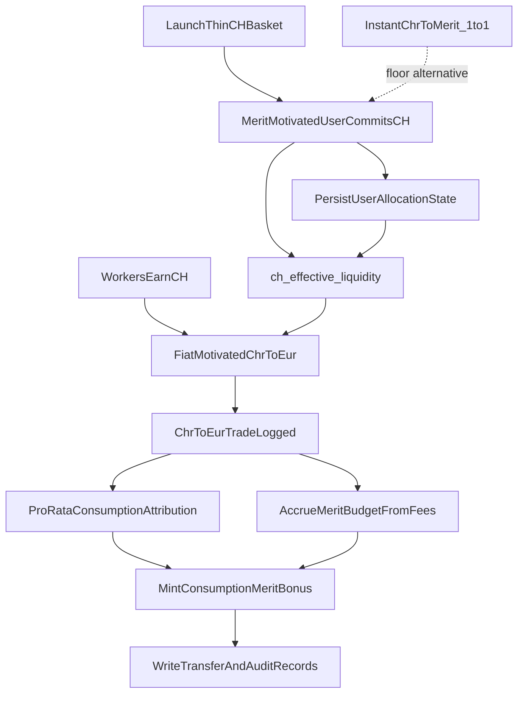

# Base Forex Liquidity Allocation Plan

## Module boundary (prefer `rovas_forex` only)
- **Default:** implement allocation settings, admin UI, user UI, cron/scheduler, merit budget accrual, merit distribution, logging, and any small schema (e.g. `hook_schema` table for snapshots/history) **inside** [`/Users/sano/Documents/homeProjects/rovas/sites/all/modules/custom/rovas_forex`](/Users/sano/Documents/homeProjects/rovas/sites/all/modules/custom/rovas_forex) so Forex liquidity stays in one module.
- **Integration without touching other modules:** use Drupal hooks from `rovas_forex` to observe events already fired elsewhere (e.g. `hook_commerce_payment_order_paid_in_full`, `hook_cron`, `hook_user_*` / `hook_form_FORM_ID_alter` only if unavoidable) and call existing Rules components via `rules_invoke_component()` from PHP in `rovas_forex` instead of editing exported Rules JSON in `rovas_site_rules`.
- **User data storage:** prefer user fields only if they already exist for this purpose; otherwise store allocation in `rovas_forex`'s own table or keyed storage, still owned by `rovas_forex.info` / install schema, to avoid scattering config across modules.
- **Documented exceptions:** if merit credit **must** go through a single canonical Rules action with no PHP equivalent, add one minimal bridge (e.g. one new Rules component invoked only from `rovas_forex`) rather than spreading logic; keep the behavioral spec in this plan.

## Goals
- Bootstrap chr→eur liquidity at launch when the CH basket is empty or thin but EUR may already be present.
- Let users opt in as base-Forex liquidity providers using both:
  - fixed CH lock amount
  - percentage-of-available-CH allocation
- Align incentives across two worker archetypes (see below): fiat-motivated sellers vs merit-motivated pool committers.
- Pay liquidity providers in merits only, with **consumption-linked bonuses** (not passive CH yield) when allocated CH backs realized chr→eur volume.
- Add admin controls for mechanism parameters, constraints, and reward policy.
- Add user UI for enrollment, limits, allocation management, and expected upside vs instant chr→merit.
- Add transparent merit budgeting and accounting tied to Forex fee activity.

## Launch economics and worker motivation

### Hypothetical launch state
- **CH basket (`ch_basket`)**: empty or near-zero (no Chrons in the reserve yet).
- **EUR basket (`eur_basket`)**: may hold seed EUR.
- **Circulating CH**: grows as workers report work and earn Chrons.

In the current Bancor implementation (`forex()` in `rovas_forex.module`), `chr_to_eur` requires a **non-zero CH input balance**; with `ch_basket = 0` the function returns no output. So the “infinitely favourable” chr→eur rate for sellers is not immediately executable—it is the **potential** rate once even a small effective CH depth exists relative to EUR. That depth must come from liquidity providers committing CH, not from work rewards alone (work mints user balances, not basket reserves).

When `eur_basket` is large relative to effective CH depth, early chr→eur sellers receive disproportionately more EUR per CH. That attracts **fiat-motivated workers** who want national currency to live on.

### Worker archetypes

| Archetype | Primary goal | Natural path | Role in liquidity plan |
|-----------|--------------|--------------|------------------------|
| **Fiat-motivated** | Cash out to EUR / national currency | Earn CH from work → chr→eur | Consumes pool depth; benefits from deep EUR basket and thin CH depth (good seller rate) |
| **Merit-motivated** | Higher-level satisfaction (Merits) | Earn CH → chr→merit (1:1 today) **or** commit CH to pool | Should prefer pool commitment when expected merit return exceeds the guaranteed 1:1 instant conversion |

The plan deliberately creates a **wedge** between:
- **Instant path**: chr→merit at 1:1 anytime (guaranteed floor, destroys CH).
- **Pool path**: lock CH as liquidity; earn merits when that depth is **used** in chr→eur trades, ideally at a rate **above 1:1** on the consumed portion.

Fiat-motivated workers are unlikely to commit CH (they need EUR). Merit-motivated workers supply the CH depth that makes fiat cash-out possible. Consumption-linked merit bonuses are the incentive for them to choose pool over instant conversion.

### Design risks and mitigations

| Risk | Why it matters | Mitigation in this plan |
|------|----------------|-------------------------|
| **Bootstrap deadlock** | `ch_basket = 0` blocks chr→eur entirely | Phase 1 uses `ch_effective_liquidity` (committed allocations × haircut) in pricing, not only physical `ch_basket`; commitments move CH into escrow/basket on enroll |
| **EUR drain at launch** | Thin CH + fat EUR ⇒ early sellers extract EUR fast; rate normalizes | Admin EUR seed policy; optional launch rate caps; monitor `eur_basket` depletion; replenish via eur→chr / merit purchases |
| **1:1 arbitrage** | Merit-lovers always take instant chr→merit unless pool EV is higher | Consumption bonus funded from chr→eur fees; UI shows expected merit/CH vs guaranteed 1:1; no bonus on idle allocation |
| **Merit inflation** | Consumption bonuses mint merits without bound | Bonus budget capped by fee-linked accrual (`buy_eur_fee` on realized chr→eur volume); prorate if demand exceeds budget |
| **Wrong LP mix** | Fiat-seekers won’t commit; pool depth depends on merit incentive strength | Expected; target UX and bonus curve at merit-motivated users; fiat users are demand side |
| **Wash trading / gaming** | Colluding chr→eur to farm LP rewards | Reward only fee-bearing chr→eur with real EUR outflow; min trade size; exclude self-trades; optional cooldown |
| **Attribution ambiguity** | Bancor trades don’t label “whose” CH was used | Pro-rata attribution: at trade time, each LP’s share = `effective_allocated_ch / ch_effective_liquidity`; consumed CH per LP = trade_input_ch × share |
| **Idle lock-up cost** | CH locked in pool cannot be spent or instantly converted | Optional small time-weighted participation stipend (low); primary upside is consumption bonus; allow de-allocation with delay |

## Existing Integration Points
- Extend existing Forex admin form and variable storage in [`/Users/sano/Documents/homeProjects/rovas/sites/all/modules/custom/rovas_forex/rovas_forex.module`](/Users/sano/Documents/homeProjects/rovas/sites/all/modules/custom/rovas_forex/rovas_forex.module).
- Reuse available CH via existing Rules components **called from PHP** in `rovas_forex` (e.g. `rules_invoke_component('rules_chrons_actually_available', ...)`) rather than duplicating logic; no requirement to edit [`rules_chrons_actually_available.json`](/Users/sano/Documents/homeProjects/rovas/sites/all/modules/custom/rovas_site_rules/rules/rules_chrons_actually_available.json).
- Accrue merit budget from **chr→eur fee revenue** by hooking the chr→eur settlement path in `rovas_forex` (or observing the existing trade completion hook/event) and updating internal budget state. Commerce order hooks (`hook_commerce_payment_order_paid_in_full`) remain relevant for eur→chr / merit-purchase inflows but are not the primary LP reward funding source.

## Functional Design
- **Allocation model**
  - Per user, store:
    - `fx_alloc_enabled` (bool)
    - `fx_alloc_fixed_ch` (decimal)
    - `fx_alloc_percent` (0-100)
    - computed/effective allocated CH snapshot
  - Effective allocated CH at settlement time:
    - `min(fx_alloc_fixed_ch + fx_alloc_percent * actually_available_ch, actually_available_ch)`
  - Protect against over-allocation by clamping to actually available CH each cycle.

- **Base basket composition**
  - Keep current `forex_baskets` as executable reserve.
  - **Launch-critical:** `ch_effective_liquidity = ch_basket + liquidity_haircut * total_user_allocated_ch`.
  - Use `ch_effective_liquidity` (not only `ch_basket`) as the CH depth input to chr→eur pricing from Phase 1 so committed allocations enable trades before the physical basket is large.
  - On enroll, move allocated CH from user balance into basket escrow (or equivalent lock) so commitments are real, not virtual-only.
  - Phase 3 (optional): feed `ch_effective_liquidity` into dynamic fee/rate multipliers with conservative caps.

- **Reward mechanism (consumption-linked, merit-only)**
  - **Instant chr→merit floor:** users can always convert CH to Merits 1:1 outside the pool (`_convert_chr_2_merits`). Pool participation is opt-in for upside above that floor.
  - **Primary reward — consumption bonus:** when a chr→eur trade executes, attribute a pro-rata share of trade input CH to each LP based on their effective allocation at trade time. For each LP:
    - `consumed_ch = trade_input_ch * (lp_effective_allocated_ch / ch_effective_liquidity_at_trade)`
    - `merit_bonus = consumed_ch * fx_consumption_merit_multiplier` (multiplier > 1, e.g. 1.2–2.0, admin-tunable)
  - **Funding:** accrue merit budget from chr→eur fee revenue (`buy_eur_fee` × EUR outflow, converted to merit units via admin ratio). If interval bonuses exceed accrued budget, prorate and log.
  - **Optional secondary — participation stipend:** small time-weighted merit payout on allocated CH (much smaller than consumption bonus) to offset idle lock-up; disable or keep minimal if consumption bonus is strong enough.
  - **No CH yield:** payout only in merits (NEO alignment).
  - Suggested policy parameters:
    - `fx_merit_rewards_enabled` (bool)
    - `fx_consumption_merit_multiplier` (decimal, > 1)
    - `fx_merit_budget_mode` (`fee_linked_budget` recommended at launch; `fixed_interval_budget` optional top-up)
    - `fx_merit_fee_link_ratio` (merits minted per EUR of chr→eur fee revenue)
    - `fx_participation_stipend_enabled` (bool, default false or low)
    - `fx_participation_stipend_per_interval` (if enabled)
  - Distribution:
    - consumption bonuses: settle per trade or batch hourly/daily from trade log
    - participation stipend: periodic cron if enabled
  - Safety:
    - enforce per-user and per-interval merit caps
    - if computed payouts exceed interval budget, prorate and log
    - reject or cap trades that would over-attribute when `ch_effective_liquidity` is below minimum threshold

## Admin Interface Additions
- Extend Forex admin page (`/admin/config/development/forex`) with sections:
  - mechanism enable switch
  - allocation bounds:
    - min fixed CH, max fixed CH
    - max percent allocation
  - liquidity haircut for effective liquidity metric
  - reward parameters:
    - consumption merit multiplier (`fx_consumption_merit_multiplier`)
    - merit budget mode and fee-link ratio
    - optional fixed-interval merit top-up
    - optional participation stipend (enable, period, amount)
    - optional per-user min/max merit reward cap
    - minimum `ch_effective_liquidity` for chr→eur execution
    - launch rate guardrails (optional cap on EUR outflow per interval)
  - operational account IDs (if internal system account is used for merit bookkeeping)
- Add validation and guardrails in the existing submit/validate handlers.

## User Interface Additions
- Add a dedicated user-facing Forex settings form route (new menu item under profile or Forex area):
  - enable/disable participation
  - set fixed CH allocation
  - set percentage allocation
  - preview computed effective allocation from current available CH
  - compare **guaranteed** instant chr→merit (1:1) vs **expected** pool upside (consumption bonus at current volume and multiplier, with disclaimer)
  - show estimated consumption-linked merit reward (informational, policy disclaimer)
- Add validation:
  - prevent invalid percent/ranges
  - prevent settings that exceed admin max constraints.

## Processing and Data Flow

## Phased Delivery
- **Phase 1: Bootstrap plumbing**
  - user settings storage + admin parameters + validation
  - CH escrow on commit; `ch_effective_liquidity` used in chr→eur pricing
  - aggregate allocated liquidity computation and reporting
  - trade log with LP allocation snapshots for attribution
- **Phase 2: Consumption-linked rewards**
  - fee-linked merit budget accrual from chr→eur activity
  - consumption attribution and merit bonus payout per trade (or batched)
  - transaction logging and anti-gaming guards
- **Phase 3: Optional refinements**
  - participation stipend for idle allocations (if needed after observing LP behavior)
  - dynamic fee/rate coupling to `ch_effective_liquidity`
  - launch rate guardrails and EUR depletion alerts

## Merit Budget Recommendation
- Default to **consumption-linked, merit-denominated rewards** (ideological alignment):
  - no CH yield for liquidity lending
  - pool beats instant 1:1 chr→merit only when allocated CH is **actually consumed** in chr→eur trades
- Suggested policy at launch:
  - fund bonuses primarily via `fee_linked_budget` from chr→eur fees (sustainable, activity-aligned)
  - set `fx_consumption_merit_multiplier` high enough to attract merit-motivated LPs, but cap total issuance via fee accrual
  - keep instant 1:1 chr→merit as the guaranteed floor so merit-lovers are never forced into the pool
- Keep user-facing language explicit:
  - fiat-motivated users benefit from favourable early rates when selling CH for EUR
  - merit-motivated users support the market by committing CH and earn **extra** merits when others cash out
  - users are rewarded for enabling exchange, not for passive capital returns

## Acceptance Criteria
- Admin can configure all mechanism and reward parameters from Forex admin UI.
- Users can manage fixed + percent allocations from a dedicated UI and see instant 1:1 vs pool upside comparison.
- System computes `ch_effective_liquidity` and uses it in chr→eur pricing when physical `ch_basket` is thin.
- chr→eur trades attribute consumed CH pro-rata to LPs and pay consumption-linked merit bonuses within fee-funded budget.
- Scheduled or per-trade payout writes auditable transfer records.
- Misconfiguration/insufficient pool or budget scenarios fail safely (no negative balances, clear logs/messages).
