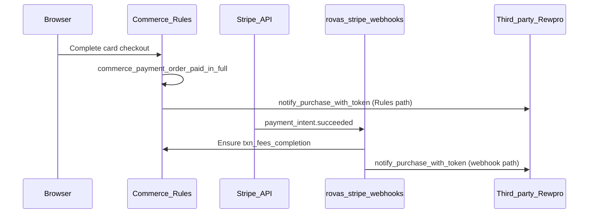

# Rewpro architecture and known shortcomings

This document summarizes how **rewpro** (third-party–initiated project rewards / premium purchase) is wired today in Drupal 7 + Commerce + Stripe, and why the system is hard to reason about. It is intended as a **handoff for refactoring** (single place to notify, clearer ownership of idempotency, fewer races).

---

## What “rewpro” is

- **User-facing entry:** `/rewpro` (and related checkout completion URLs), implemented largely in **`rovas_project_reward`**.
- **Third-party apps** deep-link users with query parameters (recipient project, amounts, callback URL, opaque **token**, expiration, pay type, language, etc.).
- **Session bridge:** `rovas_project_reward_session_get` / `_set` store a “sessary” bag under `$_SESSION['rovas_project_reward']` (token, `callback_url`, `paytype`, optional `commerce_order_id`, expiration, product name, etc.).

The third party’s server is notified when payment completes via an **outbound HTTP POST** (JSON “payment-completed” payload), not via Stripe’s dashboard webhooks. Stripe webhooks are **inbound** to Rovas; Rewpro’s URL is **outbound** from Rovas.

---

## Admin: “Rewpro webhooks” page

- **Path:** `admin/commerce/orders/rewpro-webhooks`
- **Module:** `rovas_outbound_webhook_log`
- **Storage:** table `rovas_outbound_webhook_log` (one row per delivery **attempt** logged by `rovas_project_reward_notify_purchase_with_token` when it performs `drupal_http_request`).
- **Important:** This is **not** the Stripe webhook inbox (`admin/config/services/rovas-stripe-webhooks/...`). It only reflects **outbound** calls to the project’s `field_webhook_url` (Rewpro / simulator).

---

## Outbound notify: single function, multiple callers

All Rewpro-style “payment completed” HTTP posts go through:

- **`rovas_project_reward_notify_purchase_with_token()`** in `rovas_project_reward.module`  
  - Builds JSON (`event`, `token`, HMAC `signature`, `amount_paid`, `currency`, `email`, `occurred_at`, optional `expiration`).  
  - Calls `drupal_http_request` to the project owner’s configured endpoint.  
  - Logs a row via **`_rovas_project_reward_record_outbound_webhook` → `rovas_outbound_webhook_log_record`**.

**Callers include:**

| Caller | Context | Session? |
|--------|---------|----------|
| **`rovas_project_reward_notify_purchase()`** | Invoked from **Rules** on `commerce_payment_order_paid_in_full` for card orders (see below) | Yes (token, callback, etc.) |
| **`_rovas_stripe_webhooks_maybe_notify_third_party()`** | Invoked from **`rovas_stripe_webhooks`** after `payment_intent.succeeded` processing | No (`drupal_save_session(FALSE)` in webhook dispatch) |
| **Bank / other paths** | Separate helpers that also log outbound traffic | Varies |

So the **same third-party contract** is executed from **both** an interactive checkout completion path and an **async Stripe webhook** path.

---

## Rules: card order completion → Rewpro notify

- **Default rule (in code):** `rovas_site_rules/rules/rules_process_card_payment_orders.json`  
  - Exported through **`hook_default_rules_configuration()`** in `rovas_site_rules.rules_defaults.inc`.
- **Event:** `commerce_payment_order_paid_in_full`
- **Guard:** Skips Express Checkout orders where PI metadata `context == express_checkout` (Express uses another completion path).
- **Action:** `php_eval` loads the rewarded node and calls  
  `rovas_project_reward_notify_purchase($rewarded_node, rovas_project_reward_commerce_order_total_minor_units($commerce_order), 'EUR', $email, $commerce_order)`  
  (the **fifth argument** must be present in the **active** rule so `notify_purchase` can resolve `order_id` when session does not contain `commerce_order_id`).

**Operational caveat:** If the rule was **edited in the UI**, it becomes **Overridden**; JSON on disk is not what runs until reverted/re-imported.

---

## Stripe: inbound webhooks → Commerce + optional Rewpro notify

- **Endpoint:** `stripe/webhook` → **`rovas_stripe_webhooks`**
- **Stored events:** `rovas_stripe_webhooks` table; processing in `includes/processor.inc`.
- **`payment_intent.succeeded`:** For **non–Express** card flows, order is loaded using **PaymentIntent metadata** (`order_id` / `order_number` from `commerce_stripe_pi`), then fees / completion helpers run, then **`_rovas_stripe_webhooks_maybe_notify_third_party($order, $intent)`** if PI metadata contains **`callback_token`** (and recipient resolution succeeds).

Express Checkout branches create or attach orders differently; they also call `_rovas_stripe_webhooks_maybe_notify_third_party` where applicable.

---

## PaymentIntent metadata (why it matters)

- **`commerce_stripe_pi`** already sets **`metadata.order_id`** / **`order_number`** for normal card PaymentIntents.
- **Rewpro callback persistence:** `rovas_project_reward_commerce_stripe_pi_payment_intent_data_alter()` can add **`callback_token`**, **`callback_expiration`**, **`paytype`**, **`project_id`** to PI metadata so **webhook-side** code can notify without PHP session (session is unavailable or suppressed in webhook processing).

Without `callback_token` on the PI, the webhook path **cannot** call the third party (by design in `_rovas_stripe_webhooks_maybe_notify_third_party`).

---

## Idempotency and duplicates (core shortcoming)

**Observed behaviour:** Two outbound rows for one order: first **204**, second **400** (simulator rejects duplicate token / validation).

**Root cause class:** **Two independent success paths** both call `rovas_project_reward_notify_purchase_with_token` for the same order:

1. **Rules** (synchronous with request that completes payment), and  
2. **`payment_intent.succeeded`** webhook (async, possibly overlapping in time).

Mitigations attempted in code (conceptually):

- Persist **`order->data['rovas_stripe_purchase_notified']`** after a successful HTTP response so the webhook path can skip on reload.
- Pass **`$commerce_order`** from Rules so `order_id` is known when session lacks `commerce_order_id`.
- Reload order before skip check in **`_rovas_stripe_webhooks_maybe_notify_third_party`**.
- **Lock serialization** around `notify_purchase_with_token` (per order / per token) to close the **TOCTOU** race where both paths read “not notified” before either saves.

**Why it still feels fragile:**

- Behaviour depends on **deploy parity** (PHP + active Rules revision) and **race timing**.
- **Stripe sends multiple event types** (e.g. `charge.succeeded` and `payment_intent.succeeded`); only PI success should drive Commerce completion, but operators must not misread logs.
- **Two sources of truth** for “did we tell Rewpro?” (order flag + outbound log + HTTP result) without a single domain event.

---

## Mermaid: current card (non–Express) happy path (simplified)

Any overlap between the two paths to `Rew` causes duplicate risk unless serialization and a single notion of “already notified” are bulletproof.

---

## Related documentation and files

| Area | File / location |
|------|------------------|
| Rewpro session, forms, notify | `rovas_project_reward.module` (`notify_purchase`, `notify_purchase_with_token`, `commerce_stripe_pi_payment_intent_data_alter`, session helpers) |
| Stripe webhook processing | `rovas_stripe_webhooks/includes/processor.inc` (`rovas_stripe_webhooks_process_payment_intent_succeeded`, `_rovas_stripe_webhooks_maybe_notify_third_party`) |
| Outbound log + admin UI | `rovas_outbound_webhook_log.module` + `.install` |
| Default Rules (card paid in full) | `rovas_site_rules/rules/rules_process_card_payment_orders.json` + `rovas_site_rules.rules_defaults.inc` |
| Express PI creation | `rovas_stripe_express_checkout/includes/*.inc` |
| Prior narrative on Rules vs fees | `rovas_project_reward/REWARD_RULES_ANALYSIS.md` |

---

## Refactor directions (for the next agent)

These are **goals**, not prescriptions:

1. **Single notifier:** Decide one authoritative trigger for Rewpro `payment-completed` (e.g. only after Commerce order is in a terminal paid state), and make the other path a **no-op** or a **replay-safe** queue consumer.
2. **Explicit state machine:** e.g. `pending_notify` → `notified` → `failed` stored in **one** place (order field, dedicated table, or queue item), not split across session, `order->data`, and log rows alone.
3. **Webhook-only vs Rules-only:** If webhooks are reliable enough, **remove** Rewpro POST from Rules for card and rely on PI metadata + idempotent webhook worker (or vice versa), with a clear fallback for environments without webhooks.
4. **Rules hygiene:** Document that **`rules_process_card_payment_orders`** must stay in sync with code (default vs overridden) and add a CI check or update hook if feasible.
5. **Observability:** Distinguish in logs **caller** (rules vs stripe_webhook) and **skip reason** (already_notified, lock_wait, missing_token) without spamming the Rewpro simulator.

---

## Revision

- **2026-05-09:** Initial document from production debugging (duplicate Rewpro POSTs, order id in outbound log, Rules vs webhook overlap).
